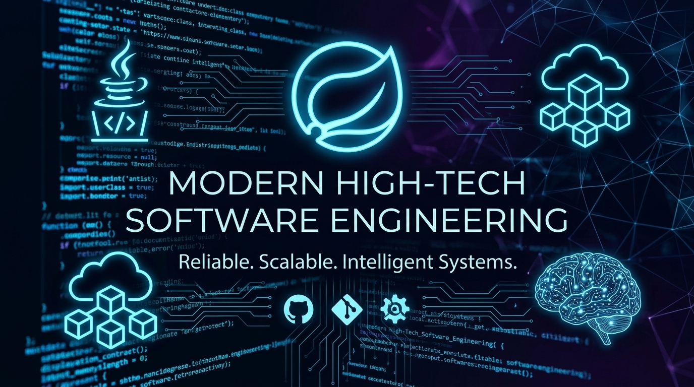

  

# DOSSIÊ TÉCNICO EXECUTIVO — CERTIFICAÇÕES E PORTFÓLIO

**Engenharia de Software | Arquitetura Java & Spring | Inteligência Artificial | Engenharia de Dados & BI**

### 🛠️ STACK TÉCNICA E TECNOLOGIAS

 

### 🛡️ AUDITORIA, SEGURANÇA E QUALIDADE DE CÓDIGO

## 📌 SOBRE ESTE REPOSITÓRIO

Este repositório centraliza o ecossistema completo de capacitação técnica, projetos práticos, certificações e portfólio de **Rafael Ornelas Tozato**. O objetivo é fornecer uma visão consolidada, auditável e de alto desempenho para processos seletivos, auditorias de código e validação de competências avançadas em tecnologia.

📄 **Dossiê Consolidado:** Você pode acessar ou baixar o arquivo completo com todo o histórico unificado diretamente na raiz do repositório: [`Dossiê Técnico Executivo.pdf`](./Dossiê%20Técnico%20Executivo.pdf).

## 🛠️ ÁREAS DE ESPECIALIZAÇÃO E CERTIFICAÇÕES

### 1. Arquitetura Backend, Java e Spring Framework
* **Design Patterns com Java: Dos Clássicos (GoF) ao Spring Framework** (10h) — *DIO* | 📜 [Certificado Oficial](https://web.dio.me/certificates) | 💻 [Repositório](https://github.com/Rafael-TOZATO/lab-padroes-projeto-java-spring.git)
* **Fundamentos da Web e Boas Práticas de Desenvolvimento com Java** (6h) — *DIO* | 📜 [Certificado Oficial](https://web.dio.me/certificates) | 💻 [Repositório](https://github.com/Rafael-TOZATO/tozato-dev-hub.git)
* **Criando sua Primeira API REST com Spring Boot & Spring Data** (8h) — *DIO* | 📜 [Certificado Oficial](https://web.dio.me/certificates) | 💻 [Repositório](https://github.com/Rafael-TOZATO/tozato-dev-hub.git)
* **Simplificando a Segurança em APIs REST com Spring Security & OpenFeign** (8h) — *DIO* | 📜 [Certificado Oficial](https://web.dio.me/certificates) | 💻 [Repositório](https://github.com/Rafael-TOZATO/tozato-dev-hub.git)
* **Princípios SOLID, Clean Code e Collections em Java** (20h acumuladas) — *DIO* | 📜 [Certificado Oficial](https://web.dio.me/certificates) | 💻 [Repositório](https://github.com/Rafael-TOZATO/tozato-dev-hub.git)

### 2. Inteligência Artificial, Agentes e Copilotos
* **Microsoft - Foundry Agentic Engineer** (15h) — *Microsoft* | 📜 [Certificado Oficial](https://www.linkedin.com/in/rafaeltozato81/details/certifications/) | 💻 [Repositório](https://github.com/Rafael-TOZATO/tozato-dev-hub.git)
* **IBM Bob: IA de Nível Empresarial para Desenvolvedores e Tech Leaders** (25h) — *IBM / DIO* | 📜 [Certificado Oficial](https://www.linkedin.com/in/rafaeltozato81/details/certifications/) | 💻 [Repositório](https://github.com/Rafael-TOZATO/bootcamp-ibm-bob-ia-empresarial.git)
* **Aceleração Santander - RAG com ChromaDB, LlamaIndex e Python** (10h) — *Santander / DIO* | 📜 [Certificado Oficial](https://web.dio.me/certificates) | 💻 [Repositório](https://github.com/Rafael-TOZATO/tozato-dev-hub.git)
* **GitHub Copilot, CLI e Prompt Engineering** (12h) — *GitHub / DIO* | 📜 [Certificado Oficial](https://web.dio.me/certificates) | 💻 [Repositório](https://github.com/Rafael-TOZATO/tozato-dev-hub.git)

### 3. Engenharia de Dados e Arquitetura Orientada a Eventos (EDA)
* **Fundamentos de Arquitetura Orientada a Eventos e Apache Kafka / Confluent Cloud** (20h) — *IBM Confluent / DIO* | 📜 [Certificado Oficial](https://web.dio.me/certificates) | 💻 [Repositório](https://github.com/Rafael-TOZATO/pipeline-pagamentos.git)
* **Pipeline Real-Time End-to-End com Confluent Cloud (Desafio Final)** (10h) — *IBM Confluent / DIO* | 📜 [Certificado Oficial](https://www.linkedin.com/in/rafaeltozato81/details/certifications/) | 💻 [Repositório](https://github.com/Rafael-TOZATO/insights-playground-52.git)

### 4. Business Intelligence e Data Analytics (Power BI)
* **Fundamentos de Data Analytics com Power BI / Modelagem Dimensional** (25h) — *Universia / DIO* | 📜 [Certificado Oficial](https://www.linkedin.com/in/rafaeltozato81/details/certifications/) | 💻 [Repositório](https://github.com/Rafael-TOZATO/aurora-bi-dio.git)
* **Dashboard Gerencial para Tomada de Decisões com MySQL e Azure** (8h) — *DIO* | 📜 [Certificado Oficial](https://web.dio.me/certificates) | 💻 [Repositório](https://github.com/Rafael-TOZATO/analise-de-vendas-financials-power-bi.git)

### 5. Automação de Processos e Workflows (N8N e Python)
* **Automação de Processos com N8N e Python** (25h) — *Santander / DIO* | 📜 [Certificado Oficial](https://web.dio.me/certificates) | 💻 [Repositório](https://github.com/Rafael-TOZATO/n8n-cobrancas-inteligentes.git)

## 📂 REPOSITÓRIOS DESTAQUE DO ECOSSISTEMA

* [tozato-ai-core.vercel.app](https://tozato-ai-core.vercel.app) 
* [h-folio-I0.vercel.app](https://h-folio-I0.vercel.app)

## 📬 CONTATOS E PERFIS

🐙 **CÓDIGOS E REPOSITÓRIOS**
* GitHub: [github.com/Rafael-TOZATO](https://github.com/Rafael-TOZATO)

✍️ **ARTIGOS E PUBLICAÇÕES**
* Medium: [medium.com/@ornelas.tozato](https://medium.com/@ornelas.tozato)
* Comunidade DEV: [dev.to/rafaeltozato](https://dev.to/rafaeltozato)

💼 **CONTATO**
* LinkedIn: [linkedin.com/in/rafaeltozato81](https://www.linkedin.com/in/rafaeltozato81)
* E-mail: ornelas.tozato@gmail.com
